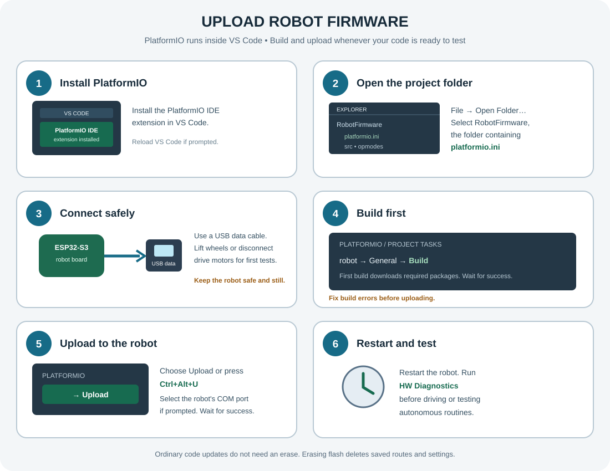
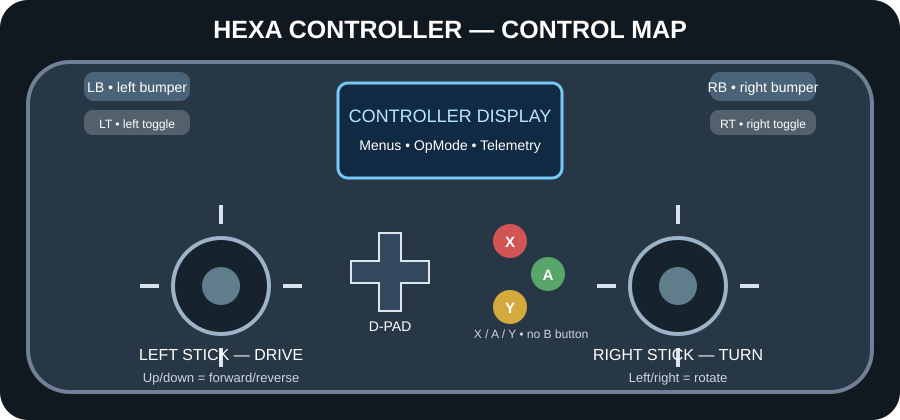
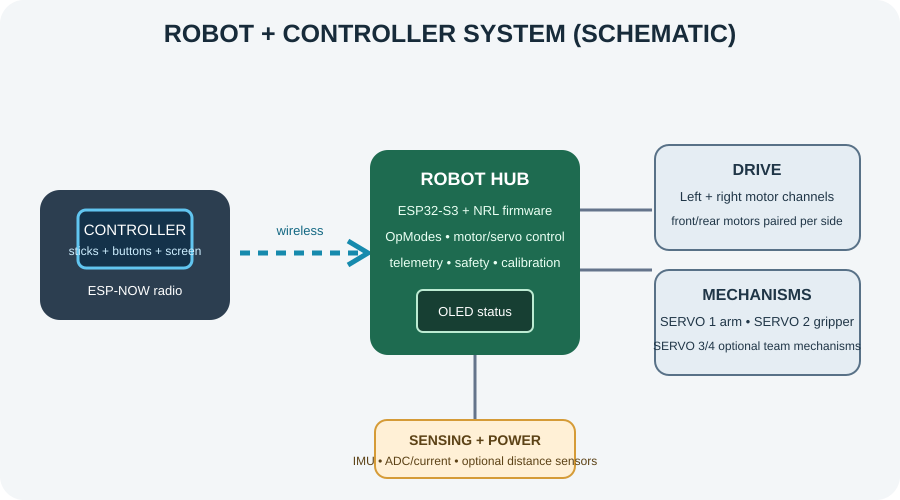

# NRL SDK
### National Robotics League · for the Hexa Command Hub

The NRL SDK is the software kit teams use to program their robots: the HexaNRL runtime, the
Hexa* hardware libraries, the project and OpMode wizards, and the Blocks editor. It runs on the
Hexa Command Hub (robot) and the NRL controller, both built on ESP32-S3. Students write only
their game logic in `opmodes/`; the SDK handles hardware, wireless comms, timing, and display.

---

## Hardware Required

| Part | Quantity | Used For |
|------|----------|----------|
| Hexa Command Hub / ESP32-S3 robot board | 1 | Robot control, motor/servo signals, sensors |
| NRL handheld controller | 1 | Driver controls and telemetry (controller firmware is prebuilt) |
| Servo motors | Up to 4 | Robot joints/arms |
| DC motors | Up to 4 | Drive system |
| 128×64 I2C OLED | 1, board-installed | Robot status display |
| LSM6DSOX IMU | 1, board-installed | Robot tilt and heading |
| MCP3008 8-channel SPI ADC | 1, board-installed | Battery, current, and external analog inputs |
| ACS712 current sensors | 2, board-installed | Main and motor-branch current sensing |
| Ultrasonic distance sensor | Optional | Obstacle distance (D1 trigger, D2 echo) |
| Analog IR distance sensor | Optional | Additional obstacle distance (ADC_EXT_1) |
| USB data cable | 1 | Firmware build/upload connection |

> **Before connecting anything:** identify the exact board revision and follow its printed
> connector labels. The repository defines GPIO signal assignments, but does not document
> the physical pin order or supply voltage of every motor, servo, digital-I/O, or ADC
> connector. Never guess connector order from a photograph or wire color. Use the board
> schematic/label and each device's datasheet. Disconnect the battery while wiring.

---

## Step-by-Step Robot Wiring

This guide matches the pin constants in `RobotFirmware/lib/HexaNRL/src/BoardPins.h` and
the on-board device setup in `RobotFirmware/lib/HexaNRL/src/RobotConfig.h`. GPIO numbers
below identify **signal pins inside the firmware**. They are not instructions to attach a
motor or a power wire directly to an ESP32 GPIO.

### 1. Prepare and identify the hardware

Gather the Hexa Command Hub/robot board, chassis, two drive sides (up to four DC motors
paired left/right), arm and gripper servos, battery approved for the hub, data-capable USB
cable, and any optional sensors. Also have the board schematic, sensor datasheets, and a
multimeter available. Put the robot on a stable stand so its wheels cannot touch the floor.

With the battery disconnected:

1. Find the board's motor-driver output terminals, servo headers, battery input, and the
   sensor headers identified below. Read their silk-screen labels.
2. Check that the motor voltage/current, servo rail, and battery are compatible with the
   hub and the connected devices. The source repository does not specify their electrical
   ratings; do not infer them from GPIO pin numbers.
3. Keep loose wires away from wheels, gears, and linkages. Do not connect or disconnect
   motors or servos while the system is powered.

### 2. Connect the two drive sides

The firmware uses two motor-driver **control signal pairs**:

| Firmware signal | ESP32-S3 GPIO | Connects to |
|---|---:|---|
| `MOTOR_L_DIR` | GPIO 5 | Left motor driver's direction input |
| `MOTOR_L_PWM` | GPIO 10 | Left motor driver's speed/PWM input |
| `MOTOR_R_DIR` | GPIO 11 | Right motor driver's direction input |
| `MOTOR_R_PWM` | GPIO 12 | Right motor driver's speed/PWM input |

On the integrated robot board, connect the left-side motor(s) to the board's left motor
driver output and right-side motor(s) to its right motor driver output, as identified by
the board labels/official diagram. If using four drive motors, the front and rear motors
on each side are paired on that side's supported output as specified by the chassis/board
instructions. GPIO 5, 10, 11, and 12 are logic-control pins: **never
connect a DC motor directly to those GPIOs**. If using a separate motor driver, its motor
outputs drive the motors; connect its direction/PWM inputs to the corresponding control
signals and follow its logic-voltage and common-ground requirements. Do not parallel
motors unless the driver and board are rated for their combined stall current.

If a wheel turns the wrong way, disconnect power and check the motor/driver wiring and the
configured right-side inversion (`flipped = true`) before changing software. Keep the
wheels raised for the first direction test.

### 3. Connect the arm and gripper servos

Use the board's labeled servo headers. The firmware signal assignments are:

| Mechanism | Firmware name | Signal GPIO | Configured starting position |
|---|---|---:|---:|
| Arm | `SERVO_1` | GPIO 39 | `ARM_ANGLE_START` (10°) |
| Gripper | `SERVO_2` | GPIO 40 | `GRIPPER_ANGLE_START` (20°) |
| Optional Cargo Bay | `SERVO_3` | GPIO 41 | `CARGOBAY_ANGLE_START` (0°) |
| Optional Vault Gate | `SERVO_4` | GPIO 42 | `VAULT_ANGLE_START` (0°) |

For each servo, align its three-pin plug with the **signal**, **servo supply**, and
**ground** labels on that exact header. The signal wire goes to the listed GPIO; the other
two wires go only to the correspondingly marked servo power and ground pins. Servo wire
colors vary by manufacturer, so follow the servo documentation rather than assuming a
color convention. The firmware's GPIO is a control signal, not a servo power source.
Confirm the board's servo-rail voltage and current capacity against the servo datasheet.
If an approved external servo supply is required, use the board's documented power
arrangement and a shared signal ground; never feed external voltage into a GPIO.

Fit the arm and gripper horns so they can move freely through their intended range.
Cargo Bay and Vault Gate are optional team-built mechanisms; leave those headers empty if
the mechanisms are not installed. Start with low-risk, unloaded movement and adjust the
limits in `RobotFirmware/opmodes/RobotCalibration.h` before operating near a hard stop.

### 4. Connect an ultrasonic distance sensor (optional)

The obstacle detector and HW Diagnostics expect a trigger/echo sensor on these external
digital-I/O signal pins:

| Header signal | Board connector signal contact | Firmware name | ESP32-S3 GPIO | Sensor wire |
|---|---|---|---:|---|
| D1 | J14 pin 2 | `DIGITAL_D1` | GPIO 35 | `TRIG` |
| D2 | J15 pin 2 | `DIGITAL_D2` | GPIO 36 | `ECHO` |
| D3 | J16 pin 2 | `DIGITAL_D3` | GPIO 37 | Not used by this ultrasonic routine |

Connect the sensor's `TRIG` to **J14 pin 2 / D1 / GPIO 35** and `ECHO` to **J15 pin 2 /
D2 / GPIO 36**. Connect sensor ground to the board's clearly labeled ground. Power the
sensor only from a supply allowed by its datasheet and the board connector.

> **Protect the ESP32 input:** some common 5 V ultrasonic modules output 5 V on `ECHO`,
> while the ESP32-S3 GPIO is a 3.3 V logic input. Do not connect a 5 V echo output directly
> to GPIO 36. Use a suitable logic-level shifter or a correctly calculated resistor
> divider, and verify the resulting voltage with a meter before connecting it. The
> repository does not document the remaining J14/J15/J16 connector contacts; do not assume
> pin 1 or pin 3 is power or ground—use the board's labels/schematic.

The code pulses D1 and measures the D2 echo. If no echo is received, the diagnostic
reports no valid distance. Mount the sensor facing forward, secure it, and keep it clear
of the arm and frame.

### 5. Connect an analog IR distance sensor (optional)

Connect the sensor's analog `OUT` to the board connector for `ADC_EXT_1` (MCP3008 CH3).
Connect sensor ground to the labeled board ground and sensor supply to a voltage permitted
by both the sensor datasheet and the board connector. The ADC connector is an **MCP3008
channel, not an ESP32 GPIO**. The other available channels are:

| Firmware name | MCP3008 input |
|---|---:|
| `ADC_EXT_1` | CH3 |
| `ADC_EXT_2` | CH4 |
| `ADC_EXT_3` | CH5 |
| `ADC_EXT_4` | CH6 |
| `ADC_EXT_5` | CH7 |

`ADC_EXT_1` is used by the autonomous obstacle detector for the Sharp IR distance input;
HW Diagnostics displays its voltage. Read it in code with
`power.readChannelVoltage(ADC_EXT_1)`. Follow the board/sensor electrical limits: keep the
analog input between ground and the board's permitted ADC input range, never apply a
negative voltage, and use an appropriate divider/conditioner if the sensor output could
exceed that range. The MCP3008's configured reference is 5.0 V; this is **not** permission
to apply 5 V to an ESP32 GPIO.

### 6. On-board sensors, display, and power monitors

These parts are connected on the robot board and are **not extra student jumper wires**:

| On-board device | Bus / firmware pins | What to do |
|---|---|---|
| LSM6DSOX IMU | I²C `Wire`; SDA GPIO 47, SCL GPIO 48; address `0x6B` | Leave its on-board connection in place. Used for heading, pitch/roll, and balance. |
| Robot OLED | I²C `Wire1`; SDA GPIO 6, SCL GPIO 7; address `0x3C` | Leave its on-board connection in place. Used for robot status/diagnostics. |
| MCP3008 ADC | SPI CS GPIO 8, SCK GPIO 14, MISO GPIO 9, MOSI GPIO 13 | On-board ADC; its CH0–CH2 are reserved for battery/current sensing. |
| Battery-voltage input | MCP3008 CH0 | Use the board's marked battery input only; never connect a battery directly to an ADC/GPIO pin. |
| ACS712 current sensors | MCP3008 CH1 main/total current; CH2 motor-branch current | Board-installed rail sensors. Do not add a second sensor to these ADC channels. Servo current is calculated as total minus motor current. |
| User RGB status LED | GPIO 38 | Board-installed; controlled by firmware. |
| Buzzer | GPIO 21 | Use the installed buzzer/marked output; do not drive a high-current load directly from GPIO. |

Although the MCP3008 reference is 5.0 V, the exact external connector power and contact
order must come from the board revision's silkscreen/schematic. Do not connect external
I²C/SPI devices to these on-board buses unless you have checked voltage levels, pull-ups,
address conflicts, and the board wiring first.

### 7. Power up, check, and test in order

1. Recheck every connection against the board labels and this table. Confirm there are no
   loose strands, shorts, reversed plugs, or wires near moving parts.
2. With the robot still restrained and wheels raised, connect the battery to the board's
   marked battery input. Keep motor/servo rails idle during the first power-on so the
   ACS712 current sensors can capture a clean zero-current baseline.
3. Connect the robot board to the computer with a USB **data** cable. Open the
   `RobotFirmware` folder in VS Code, build with PlatformIO, then upload only after a
   successful build.
4. Set the handheld controller's WiFi Channel to **6**, matching this repository's
   `-DNRL_WIFI_CHANNEL=6` setting. Power on the controller and robot and verify the
   telemetry link.
5. Start `HW Diagnostics` first. Test one motor side at a time (`X` = left, `A` = right),
   then select and gently sweep each installed servo. Check battery/current, IMU, OLED,
   ultrasonic, and IR readings. Keep hands clear and stop immediately if a motor, servo,
   wire, or driver becomes hot, noisy, or stalls.
6. Only after basic checks pass, run the Calibration Tool and measure drive/servo travel
   on the real chassis. Update calibration constants, rebuild, and retest before trying
   autonomous modes. Perform the first drive test in a clear area with a spotter.

### 8. Common wiring mistakes to avoid

- Never connect a DC motor to an ESP32 GPIO; use the board's motor-driver output.
- Never power a servo from its signal GPIO; use the labeled servo supply and ground.
- Never feed 5 V sensor outputs directly into ESP32 digital GPIO; level-shift them first.
- Never connect battery positive directly to an ADC or GPIO.
- Do not treat `ADC_EXT_1`…`ADC_EXT_5` as GPIO numbers; they mean MCP3008 CH3…CH7.
- Do not wire a second current sensor to CH1/CH2; the board's ACS712 sensors already use them.
- Do not guess header power/ground contact positions or trust wire color alone.
- Do not test a route with wheels on the floor until the motor directions, servo limits,
  sensor readings, and stop behavior have been checked with the wheels raised.

### Curriculum connection

This project can be used to practice the engineering cycle of identifying a challenge,
planning a mechanism and control system, wiring and programming it, testing safely,
measuring results, and iterating from evidence. The wiring tables above tie those activities
to this repository's actual board signals and firmware. The public NRL Youth Dashboard URL
serves a client-rendered portal and did not expose its curriculum text in the accessible
page source, so this section is a project-to-engineering-learning mapping—not a quotation
or claim about specific official lesson wording. Check the curriculum in the signed-in
dashboard and your mentor's instructions for any additional required terminology or rules.

---

## Power & Current Sensing (MCP3008)

The robot board carries an **MCP3008** (8-channel, 10-bit SPI ADC) that reads the battery
voltage and two ACS712 current sensors. There are two ways you read the data:

**Battery voltage** — the always-available `power` object (board-level, no declaration needed):

```cpp
power.getBatteryVoltage();   // robot pack voltage (V)
power.isBatteryLow();        // true when the pack is low
```

**Rail current** — read it directly from `power` (board-level, no declaration needed):

```cpp
power.getMainCurrent();      // total battery current (A) — CH1
power.getMotorCurrent();     // DC-motor branch current (A) — CH2
power.getServoCurrent();     // servo rail current (A) — derived: main − motor
```

> ⚠️ There is **one ACS712 per rail**, not one per motor/servo, and there is no dedicated
> servo-current sensor at all — servo current is *derived* as (main total − motor branch).
> `HexaDCMotor`/`HexaServo` intentionally have no `getCurrent()` of their own (it used to
> exist and just proxied to the same shared reading per motor/servo, which looked like
> individual per-device data but wasn't) — read the rail directly through `power` instead.

The robot's battery voltage is also sent to the Controller and shown in its header.

**MCP3008 channel map** (ADC inputs are distinct from the SPI communication pins; see
`RobotFirmware/lib/HexaNRL/src/BoardPins.h`):

| MCP3008 input | Signal |
|---------------|--------|
| CH0 | On-board battery-voltage sensor |
| CH1 | On-board ACS712 #1 — main/total current |
| CH2 | On-board ACS712 #2 — DC-motor branch current |
| CH3–CH7 | External ADC connectors `ADC_EXT_1`–`ADC_EXT_5` |

The MCP3008 communicates with the ESP32-S3 over its dedicated SPI pins: CS = GPIO 8,
SCK = GPIO 14, MISO = GPIO 9, MOSI = GPIO 13. These are board-internal connections; do
not wire an external ADC to them for the normal project setup.

**Calibration:** VREF = **5.0 V** on this board (not 3.3 V). Defaults come from the verified
manufacturer batch logs (CH0 941 counts → 11.35 V ⇒ `vbattScale ≈ 2.468`). For trustworthy amps,
put a DMM in series and adjust `HexaPowerConfig.acsSensitivity`; for trustworthy volts, compare CH0
against a DMM and adjust `vbattScale`. Keep the rails idle at power-up so `begin()` captures a clean
ACS712 zero offset. The **HW Diagnostics** and **Driver TeleOp** modes report live battery
voltage and current telemetry; there is no separate "Power Test" OpMode in this repository.

---

## External I/O

The board also breaks out **3 external digital-I/O headers** and **5 external ADC ports**, named in
`RobotFirmware/lib/HexaNRL/src/BoardPins.h`:

| Name | Signal GPIO / Channel | Header signal contact |
|------|------------------------|-----------------------|
| `DIGITAL_D1` | GPIO 35 | J14 pin 2 |
| `DIGITAL_D2` | GPIO 36 | J15 pin 2 |
| `DIGITAL_D3` | GPIO 37 | J16 pin 2 |
| `ADC_EXT_1` … `ADC_EXT_5` | MCP3008 CH3 … CH7 | Corresponding labeled external ADC connector |

Read an external ADC port with the global `power` object: `power.readChannelVoltage(ADC_EXT_1)`.
The GPIO/channel is the signal assignment, not a connector's complete pinout; use the
board silk-screen/schematic to identify ground and supply contacts.

This firmware uses D1 as the ultrasonic trigger and D2 as the echo input in
`HW Diagnostics`, the Calibration Tool, and autonomous obstacle detection. `ADC_EXT_1`
is read as the analog IR input. The repository does not currently register a standalone
`IO Test` OpMode; D3 and ADC_EXT_2…ADC_EXT_5 are available for custom sensor code.

---

## Software Required

1. [VSCode](https://code.visualstudio.com/)
2. [PlatformIO IDE extension](https://platformio.org/install/ide?install=vscode) for VSCode

That's it. PlatformIO automatically downloads all library dependencies on first build.

---

## Getting Started

Every team project starts from the **project wizard**. It stamps your team number into the
project (which picks your radio channel), writes your `<ProjectName>.code-workspace`, and opens
it. Don't open or build the downloaded kit folder directly; run the wizard first.

**1. Get the kit.** Download the latest `.zip` from [Releases](../../releases) and extract it,
or click **"Use this template"** on GitHub and clone your copy.

**2. Run the project wizard** (nothing needs to be open first):
- Windows: double-click **`tools\new-nrl-project.bat`**
- macOS: double-click **`tools/new-nrl-project.command`**
- Linux: run **`bash tools/new-nrl-project.sh`**

It asks for **project name**, **team number**, **team name** and **location**, then creates the
project.

**3. Start coding.** Your new project opens in VS Code. Create OpModes with **`NRL: New OpMode`**
(see *Writing Your Code* below) and Build/Upload. PlatformIO installs dependencies on the first
build.

Non-interactive use:
```
py -3 tools/nrl_new_project.py --name MyBot --team 7539 --dir C:\Projects --yes
```
Requires **Python 3** (PlatformIO already ships one; on Windows the `py` launcher is used).
See [tools/README.md](tools/README.md) for all options.

#### What the team number does
NRL has no roboRIO-style deploy target, so the team number instead selects the **ESP-NOW radio
channel**, round-robin over the non-overlapping channels **1, 6 and 11** (team 1 → 1, team 2 → 6,
team 3 → 11, team 4 → 1, …). The robot firmware generated for a project is pinned to that channel
via `-DNRL_WIFI_CHANNEL`, which spreads kits out when several run in one room. **Set the
controller's WiFi Channel screen to the same channel.** (Channel is a soft RF split — the button +
4-digit pairing still keeps kits logically separate.) At a competition, every robot on one field
must share that field's channel instead; set it with `py -3 tools/set-competition-channel.py`.

> **Maintainers:** this source repo is opened with `NRL_Update_1.code-workspace` at its root.
> The student kit doesn't ship that file; students always start from the wizard.

---

## Flashing the Firmware

### Robot (Bot)
You can build and upload during development; you do not need to wait until the robot or
program is complete. Each successful upload replaces the firmware currently on the robot.



1. **Install the tools.** Install [VS Code](https://code.visualstudio.com/) and its
   **PlatformIO IDE** extension. PlatformIO is an extension that runs inside the normal
   VS Code window; it is not a separate editor. If you have just installed it, reload or
   restart VS Code.
2. **Open the project.** In VS Code, choose **File → Open Folder…** and select the
   `RobotFirmware` folder—the folder containing `platformio.ini`. You can open it in a
   new VS Code window; that is normal. If you are starting from the downloaded kit, first
   create your team's project with the project wizard under **Getting Started**, then open
   the generated project's `RobotFirmware` folder.
3. **Connect safely.** Connect the robot's ESP32-S3 to the computer using a USB **data**
   cable, not a charge-only cable. For initial tests, lift the wheels clear of the floor
   or disconnect the drive motors.
4. **Build before uploading.** Open PlatformIO's alien-head icon in the VS Code Activity
   Bar, then use **Project Tasks → robot → General → Build**. You can also use the
   PlatformIO **Build** button. On the first build, PlatformIO downloads the platform and
   library dependencies; allow it to finish. Continue only after the build succeeds and
   fix any reported compile errors first.
5. **Upload to the robot.** With the robot connected, choose **Upload** from the same
   PlatformIO controls, or press `Ctrl+Alt+U`. If asked, select the COM/serial port for
   the robot (on Windows, you can check **Device Manager → Ports (COM & LPT)** while
   unplugging and reconnecting it to identify the port). PlatformIO builds if needed and
   transfers the compiled firmware; you do not copy source files onto the robot. Wait for
   the upload to report success before disconnecting the USB cable.
6. **Test after upload.** Restart the robot and run **HW Diagnostics** first. Use
   **Calibration Tool** to measure the real robot before driving it or relying on
   autonomous routes.

If PlatformIO controls are missing, confirm the opened folder itself contains
`platformio.ini`, make sure the PlatformIO IDE extension is enabled, and reload the VS
Code window. If no robot port appears, try a known data cable and another USB port, then
reconnect the robot and check Device Manager. Close any serial monitor using that port
before uploading. If the upload still cannot connect, follow the ESP32-S3 board's
documented boot/download-mode procedure and retry.

This project uses an expanded NVS partition for Teach & Repeat saved routes. When
installing this layout for the first time over older firmware, erase the robot's flash
once, then upload again so the new partition table is applied. In the PlatformIO terminal,
run `pio run -t erase` from `RobotFirmware`, then click **Upload**. Erasing deletes saved
routes and other flash settings; do not erase for an ordinary code update.

#### Updating code after it has been uploaded
The robot runs a compiled firmware image; editing files on your computer does not change
the program already on the robot. To make a change, edit the source in
`RobotFirmware/opmodes/` (or the relevant configuration/library file), save it, then
**Build** and **Upload** again using the same steps above. The upload replaces the
firmware on the connected robot. Keep the project files under version control or make a
backup so you can restore earlier code. You normally do not need to erase flash for
ordinary code edits; erase only when you need to reset flash or apply a changed partition
layout. After each update, test safely and rerun calibration if you changed drive,
mechanism, sensor, or route behavior.

### Controller (Handheld)
The controller ships as a **prebuilt binary** — there is nothing to compile.
1. Connect the Controller ESP32-S3 via USB (use a **data** cable, not charge-only)
2. **Windows:** double-click `ControllerFirmware\flash-controller.bat`
   **macOS / Linux:** run `bash ControllerFirmware/flash-controller.sh`
   (or in VS Code: `Ctrl+Shift+P` → `Tasks: Run Task` → **`NRL: Flash Controller`**)
3. Everything else is automatic: Python and esptool are installed if missing, and
   the controller's serial port is detected by its USB chip (phantom system COM
   ports like Intel AMT "SOL" are skipped). If several candidate ports exist,
   you'll be asked to pick from a short list.
4. Afterwards, pick your team's channel on the controller's **WiFi Channel** screen

Both devices communicate wirelessly via **ESP-NOW** — no WiFi router needed.

## Using the Hexa Controller with This Robot





These are original **logical schematics**, not product photos or exact-to-scale hardware
drawings. Button labels and robot connections reflect this project's firmware. For additional
NRL program and robot resources, see the [NRL Youth Dashboard](https://nrlportal.theinnovationstory.com/#/youth-dashboard).

### Connect and start a mode

1. Power on the robot and controller. On the controller, set **WiFi Channel** to the same
   channel configured in `RobotFirmware/platformio.ini`; both devices must use the same
   channel to communicate.
2. Use the controller's on-screen OpMode menu to select a mode. Follow the screen's prompts
   to initialize and start it. **TELEOP** modes respond to your controls; **AUTO** modes run
   their programmed route after start.
3. Use the controller's on-screen stop/exit control to end a run. Keep the robot restrained
   or wheels raised during first tests. Check that the selected OpMode and robot are ready
   before starting any autonomous routine.

The controller provides two analog sticks, a D-pad, `X`, `A`, `Y`, left/right bumpers
(`LB`/`RB`), and left/right toggles (`LT`/`RT`). This controller has **no B button**.
During an OpMode, `Y` is available to the running program; in menus it may act as Back.
Telemetry appears on the controller display, and supported OpModes also show status on the
robot OLED.

### Controls by OpMode

| Controller mode | How to operate it |
|---|---|
| **Driver TeleOp** | Left stick up/down drives forward/reverse; right stick left/right turns. Hold `LB` for 35% precision speed. Press `X` to close the gripper, then raise the arm to carry. D-pad `UP` selects High Pole and `DOWN` selects floor; `RB` selects Apex Pole. `A` toggles the gripper, `Y` toggles the optional Cargo Bay, and `RT` toggles the optional Vault gate. Watch battery/current and mechanism telemetry. |
| **HW Diagnostics** | Press `X` to test the left drive channel and `A` for the right. D-pad `LEFT`/`RIGHT` selects a servo; hold `UP`/`DOWN` to sweep it. `Y` tests the buzzer and `LB` cycles the LED. Check OLED/controller sensor readings. Keep clear of moving parts; optional sensors and mechanisms show readings or operate only if installed. |
| **Calibration Tool** | From its menu: `X` starts the 5-second odometry test, `A` selects arm sweep, `Y` gripper, `RB` Cargo Bay, `LB` Vault gate, and `RT` balance/IMU test. During servo tests, D-pad `UP`/`DOWN` changes by 5 degrees and `RIGHT`/`LEFT` fine-tunes by 1 degree. `LT` returns to the calibration menu. Measure physical travel and update `RobotCalibration.h` on the computer; then rebuild and upload. |
| **Star Map Setup** | Before an AI match, run this TELEOP mode. D-pad `UP`/`DOWN` selects `GOLD-SQUAD-GOLD`, `SQUAD-GOLD-GOLD`, or `GOLD-GOLD-SQUAD`; press `A` to confirm. Stop setup, then choose the Red or Blue AI mode. The selection is held in RAM and resets when firmware restarts. |
| **Teach & Repeat AI** | Sticks drive manually. `X` starts and stops route recording (stopping optimizes it); `Y` optimizes again; `A` starts replay or aborts replay. `LB` toggles the gripper; D-pad `UP`/`DOWN` adjusts the arm; D-pad `RIGHT`/`LEFT` changes replay speed. Hold `RB+Y` for 1.2 seconds to save the optimized route; hold `RB+LT` for 1.2 seconds to erase the saved and in-memory route. Use telemetry/OLED flash status to confirm. |
| **AI Driver: Red / Blue / Skills** | These are autonomous modes, not stick-driving modes. Select the appropriate arena/skills routine and start only when the robot is in its prescribed start position and the field is clear. The routine controls drive and mechanisms. Obstacle detection/avoidance depends on the corresponding sensors being installed and correctly wired. |

`LT`/`RT` refer to the controller's toggle inputs (not the analog triggers found on some
gamepads). Controls are defined by each OpMode; a button may serve a different purpose in a
different mode. Check that mode's row above before pressing it.

---

## Troubleshooting

**PlatformIO: `UnknownPlatform ... espressif32 ... version=None`**
This means the local `espressif32` platform package is corrupted or half-installed
(usually from an interrupted download), not a problem with this repo. Fix it with:
```
pio platform uninstall espressif32
pio platform install espressif32
```
If that doesn't help, delete `~/.platformio/platforms/espressif32` (Windows:
`%USERPROFILE%\.platformio\platforms\espressif32`) and rebuild — PlatformIO
re-fetches it automatically.

**`new-nrl-project.bat` / `new-nrl-opmode.bat` say Python wasn't found, or open the
Microsoft Store**
A fresh Windows install has no real Python, so `python`/`py` resolve to the Store's
placeholder stub. Just re-run the launcher — it calls `tools/ensure-python.ps1`,
which detects this and installs a real Python 3 automatically (via winget or the
official python.org installer), then continues. This needs internet access on
first run only.

**`flash_controller.py` says `No module named esptool`**
It now installs esptool automatically into whichever Python runs it the first
time you flash — just re-run it. If that fails (no internet, or pip unavailable
for that interpreter), install it manually with `pip install esptool` and try again.

**Controller flash fails with `Failed to connect to ESP32-S3: No serial data received`**
Old versions of the flasher let esptool guess the port, and on many school/office
laptops it guessed a phantom system port (Intel AMT "SOL") instead of the
controller. The flasher now picks the port by its USB bridge chip and skips
phantom ports. If it reports **no USB serial device at all**: swap in a known-good
**data** USB cable (many are charge-only), plug directly into the laptop (no
hub/dock), and if the board still never appears in Device Manager under
"Ports (COM & LPT)", install the CP210x driver:
https://www.silabs.com/software-and-tools/usb-to-uart-bridge-vcp-drivers

---

## Writing Your Code

Your robot code lives in **`RobotFirmware/opmodes/`**, which is empty in the student kit
(this source repo keeps maintainer test and sample OpModes there). Each file there is
one OpMode, a program you pick from the Controller menu. Create one with
`Ctrl+Shift+P` → `Tasks: Run Task` → **`NRL: New OpMode`** (or run
`tools\new-nrl-opmode.bat` / `bash tools/new-nrl-opmode.sh`). That writes the skeleton below,
with the `REGISTER_OPMODE` line already in place.

Every OpMode inherits from `NRLOpMode` and overrides only the hooks it needs (all four are
optional):

| Hook | When it runs |
|------|--------------|
| `init()` | Once, when INIT is pressed. `begin()` your hardware here. Keep it short: never block or `delay()`. |
| `start()` | Once, when the match starts, right before the first `loop()`. Queue an AUTO routine here. |
| `loop()` | **100 Hz**. TELEOP runs for 2:30, AUTO for 60 s. |
| `stop()` | Once, on STOP. Stop your motors and servos here. |

A small TeleOp (tank drive plus a gripper on a button):

```cpp
#include "NRL.h"

// Declare hardware at file scope. Pin names come from BoardPins.h.
static HexaDCMotor leftMotor {{ .dirPin = MOTOR_L_DIR, .pwmPin = MOTOR_L_PWM }};
static HexaDCMotor rightMotor{{ .dirPin = MOTOR_R_DIR, .pwmPin = MOTOR_R_PWM, .flipped = true }};
static HexaServo   gripper   {{ .signalPin = SERVO_1, .startAngle = 15.0f }};
static TankDrive   drive(leftMotor, rightMotor);

class MyTeleOp : public NRLOpMode {
public:
    void init() override {
        gripper.begin();      // servos first, then motors
        leftMotor.begin();
        rightMotor.begin();
    }

    void loop() override {
        drive.drive(gamepad1.leftY(), gamepad1.rightX());   // forward/back + turn

        if (gamepad1.justPressed(BTN_X)) gripper.setPosition(15);   // open
        if (gamepad1.justPressed(BTN_A)) gripper.setPosition(90);   // close

        telemetry.addData("left Y", gamepad1.leftY());
    }

    void stop() override {
        drive.stop();
        gripper.detach();
    }
};

REGISTER_OPMODE(MyTeleOp, "My TeleOp", TELEOP);
```

### Registering an OpMode

The `REGISTER_OPMODE(ClassName, "Display Name", TELEOP);` line (or `AUTO`) at the bottom of
the file is what puts the OpMode on the Controller menu. Without it, the code compiles but
never appears.

### Rules of thumb

- **No `delay()`.** Use actions (`runAction(sequential({ ... }))`, `sleep_ms()`) for timed
  sequences. In AUTO, queue the routine once in `start()`. In TELEOP, queue it on a button
  press with `justPressed()`, never every tick.
- **Control each part in one place**, either `loop()` or an action, not both.
- **Telemetry:** use `telemetry.addData("key", value)`. It's sent to the Controller automatically.
- **Battery and current:** the global `power` object (see *Power & Current Sensing* above).

`NRLOpMode.h` documents the full lifecycle and the action helpers (`instant`, `sequential`,
`parallel`, `sleep_ms`, `wait_until`, `cancelActions`, `isActionRunning`).
`NRLGamepad.h` lists every button and stick. The board has X, A, Y and the D-pad but **no B
button**.

---

## Hardware Diagnostics OpMode

The **`HW Diagnostics`** TELEOP mode is available from the Controller menu for bench and pit checks:

| Control | Test |
|---------|------|
| `X` | Run the left motor forward for 1 second, then reverse for 1 second. |
| `A` | Run the right motor forward for 1 second, then reverse for 1 second. |
| D-pad `LEFT` / `RIGHT` | Select the active servo: arm, gripper, Cargo Bay, or Vault gate. |
| Hold D-pad `UP` / `DOWN` | Sweep the selected servo between its configured limits and back. |
| `Y` | Play three short buzzer beeps. |
| `LB` | Cycle the user LED through red, green, blue, and off. |

The robot OLED displays ultrasonic distance, external ADC voltage, battery voltage, motor and servo rail current, and IMU pitch, roll, and heading. The same readings and current test status are also sent as Controller telemetry.

The BaseBot construction guide shows four drive motors arranged as left/right sides, while this firmware exposes two production motor channels. The motor tests address those two channels; front and rear motors on each side must be wired to the corresponding channel to test them together. The guide includes the arm and gripper servos. Cargo Bay and Vault gate servos are optional team-built mechanisms, not part of the documented BaseBot assembly. Servo sweeps are limited to the configured RobotCalibration target ranges rather than the servos' full electrical travel. Confirm all moving parts are clear before running tests; ultrasonic and IR readings require those optional sensors to be installed.

## Driver TeleOp and Star Map Setup

The **`Driver TeleOp`** mode provides tank drive (left stick Y / right stick X), hold `LB` for
35% precision speed, `X` to close the gripper and lift to carry, D-pad up/down for High Pole/floor,
`RB` for Apex Pole, `A` to toggle the gripper, `Y` to toggle the Cargo Bay, and `RT` to toggle
the Vault gate. Its telemetry includes battery voltage with a warning below 11 V, motor current,
arm angle, gripper state, and speed mode. Cargo Bay and Vault controls require those optional
mechanisms to be installed.

To select an autonomous Star Map, run **`Star Map Setup`** as TELEOP, use D-pad up/down to select
one of the three patterns, and press `A` to confirm. Stop that mode and then select **`AI Driver:
Red`** or **`AI Driver: Blue`**; the selected pattern is shared with both autonomous modes until
the firmware restarts. The SDK has no repeated pre-start/init hook, so selection cannot be
confirmed before INIT as requested in the task; the setup mode is a separate, explicit step
before starting AUTO. The autonomous pattern routines use the existing route distances as initial
field assumptions; rehearse and tune them on the robot before competition.

---

## Library Overview

| Library | Purpose |
|---------|---------|
| **HexaNRL** | The robot runtime: OpMode lifecycle, match timing, wireless link, gamepad, telemetry, actions, `TankDrive`. Ships precompiled in the student kit. |
| **HexaServos** | `HexaServo` (PWM servos) and `HexaDCMotor` (DC motors) |
| **HexaIMU** | LSM6DSOX 6-DOF IMU driver with non-blocking heading (wraps Adafruit_LSM6DSOX) |
| **HexaOLED** | SSD1306 OLED display driver (I²C) |
| **HexaPower** | MCP3008 ADC: battery voltage and ACS712 rail current (HexaNRL provides the global `power` instance) |
| **HexaLED** | NeoPixel status and user LED |
| **HexaHAL** | Hardware abstraction interfaces |

Third-party dependencies (fetched by PlatformIO on first build): Adafruit NeoPixel,
Adafruit LSM6DS and Adafruit Unified Sensor.

---

## Project Structure

```
RobotFirmware/              ← Flash this to the robot
├── opmodes/                ← YOUR CODE: one .cpp per OpMode
├── src/RobotMain.ino       ← Entry point (do not edit)
├── lib/HexaNRL/            ← Robot runtime (do not edit)
└── boards/                 ← Custom board definition (reference only; platformio.ini
                               still targets the stock esp32-s3-devkitc-1 profile)
ControllerFirmware/         ← Controller firmware (the student kit ships it as a
                               prebuilt image + flasher; nothing to build there)
lib/                        ← Hardware drivers (HexaServos, HexaIMU, HexaOLED, HexaPower, HexaLED, HexaHAL)
tools/                      ← Project and OpMode generators, Blocks editor
```
---

## Git pull and push commands 

git pull origin main

 Commit and push your changes:
 git status
git add <files>
git commit -m "Describe your changes"
git push origin main

To push an existing commit, just run:
git push origin main


---

---

## AI Features & Autonomous Systems

This project includes two advanced AI-driven features designed for high precision and competition excellence:

### 1. Teach & Repeat AI (`TeachAndRepeatOpMode.cpp`)
Registered in the Controller menu as **`Teach & Repeat AI`** (TELEOP).

A demonstration-learning engine that allows a driver to record a routine once and replay it with machine precision and optimized speed.

- **Demonstration Capture:** Records drive sticks, arm elevation, gripper state, and LSM6DSOX gyro heading at 20 Hz (up to 60 seconds).
- **Trajectory Optimization:** Prunes driver hesitation and dead-time from the start and end, accelerates the timeline (default 1.35x, adjustable up to 2.50x), and boosts straightaway speeds.
- **Closed-Loop Gyro Heading Lock:** Replays using active proportional steering against recorded target headings to eliminate carpet drift.
- **Dynamic Voltage Compensation:** Adjusts motor PWM in real time as battery voltage drops to ensure consistent travel distance.
- **Active Collision Avoidance:** During replay, monitors for obstacles/robots using ultrasonic/IR sensors and motor current. If blocked, halts immediately to prevent fouls (Rule G4.8), freezes the playback timeline without losing state, and executes an evasive bypass if blocked for more than 1.5 seconds!

**Controls:**
- `X`: Start / Stop recording (auto-optimizes on stop).
- `Y`: Re-run optimization.
- `A`: Start autonomous replay / Stop replay early.
- `LB`: Toggle gripper (Open 20° / Closed 90°).
- `D-Pad UP / DOWN`: Step arm elevation (+/- 15°).
- `D-Pad RIGHT / LEFT`: Increase / Decrease speedup multiplier.
- `LT`: Emergency abort to manual IDLE.
- Hold `RB + Y` for 1.2 seconds: Save the optimized route to flash.
- Hold `RB + LT` for 1.2 seconds: Clear the saved route and in-memory route.

Teach & Repeat loads a validated saved trajectory during INIT. The OLED reports `SAVED TO FLASH`,
`LOADED FROM FLASH`, or `NO SAVED ROUTE`; Controller telemetry shows the flash state as well.

---

### 2. Autonomous AI Driver with Collision Avoidance (`AIDriver*.cpp`)
Fully autonomous, hands-off self-driving modes tailored specifically to the **NRL 2026 HYPERDRIVE** game arenas:

| Mode on Controller | Source File | Description |
| :--- | :--- | :--- |
| **`AI Driver: Red`** | `AIDriverRedField.cpp` | Autonomous driver for Red Squad (starts in Red Start Zone). |
| **`AI Driver: Blue`** | `AIDriverBlueField.cpp` | Autonomous driver for Blue Squad (starts in Blue Start Zone). |
| **`AI Driver: Skills`** | `AIDriverSkillsChallenge.cpp` | High-yield autonomous cycle for the solo Autonomous Skill Challenge. |

#### Complete Match Gameplay Cycle
1. **Spike Mark & High Pole Scoring:** Drives to pre-placed Spike Marks, intakes Core, and stacks onto the High Pole (130 mm height, **+3 pts**).
2. **Payload Delivery (Rule R9.4):** Retrieves custom team Payload from Source Zone with the independent Cargo Bay mechanism (`SERVO_3`) and scores into Drop Zone (**+10 pts** + reduces Starburst activation threshold from 10 Cores down to 4 Cores).
3. **Vault Access & Star Map:** Approaches Squad Vault (`SERVO_4`), retrieves Golden Core, and scores onto Star Pole according to the Star Map (**+7 pts** + Star Map Bonus).
4. **Space Station Auto-Balance (Rule 3.3.3):** Navigates up the Space Station ramp and runs an active closed-loop balance loop reading accelerometer pitch to level the platform within +/- 2.5 degrees for a **15-point BALANCE**!
5. **Apex Pole Finish (Rule 3.3.4):** Extends arm to the Apex Pole (365 mm) for the final high-value score (**+9 pts**).

#### Real-Time Collision Avoidance & Dynamic Rerouting
Equipped with multi-modal detection via `ObstacleDetector` in `AIDriverCommon.h`:
- **Sensors:** Ultrasonic on `DIGITAL_D1`/`D2` (GPIO 35/36), Sharp IR on `ADC_EXT_1`, motor current stall sensing, and IMU deceleration.
- **Dynamic Rerouting (`smartDriveInches`):**
  - **Immediate Evasive Brake:** Halts within 30 cm of opposing robots to prevent rule G4.8 penalties.
  - **Crossing Detection:** Waits 500 ms for crossing robots to clear before resuming.
  - **Autonomous Bypass:** If permanently blocked, turns out by 35°, drives 14" past the obstacle envelope, counter-turns back to original heading, and finishes the task!

---

## License

MIT — free to use, modify, and distribute for educational and competition purposes.
